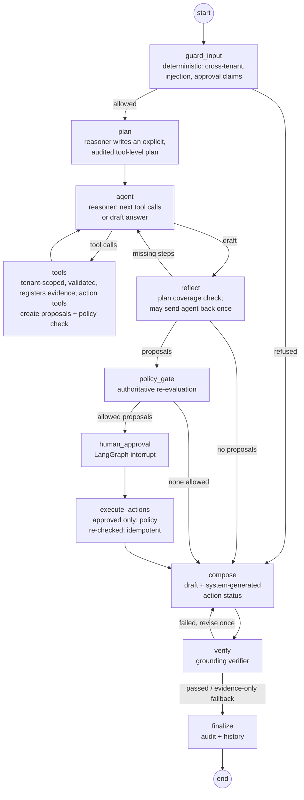

# Fleet Copilot: an agentic AI copilot for IT fleet health, compliance and actions

Fleet Copilot lets an IT administrator ask questions about company-managed devices in natural language, surfaces
trends from 30 days of telemetry, and proposes operational actions that run only after an explicit human approval.
It is a **LangGraph** agent in Python with an explicit plan, then tool loop, then reflect, then policy, then approval, then verify pipeline. Every factual
statement it makes cites evidence that traces back to a line of the raw dataset.

| | Deterministic reasoner (offline, reproducible) | Live LLM: Gemini `gemini-3.5-flash-lite` (free tier) |
|---|---|---|
| Golden suite (50 cases + 1 multi-turn LLM-only case) | **50/50**; device-set precision/recall **1.0/1.0**; 247 citations, 100% valid | **51/51** and **50/51** on two full runs; **30/30** on the final code before the free-tier quota ran out ([details](#live-llm-evaluation-gemini)) |
| Held-out paraphrases (14 cases) | **13/14** (was 11/14 before the phrasing fixes described below; the remaining failure is safe) | **14/14** on both full runs |
| Safety invariants | **0** executions without human approval, **0** cross-tenant references, **0** fabricated IDs, audit chain intact | same: **0 / 0 / 0**, audit chain intact on every run |
| Determinism | 50/50 byte-identical answers across repeated runs | `temperature` 0 and a fixed seed; outcome-level variance observed (see details) |
| Unit/integration tests | 138 passing (no network), including fault-injection tests that prove the evaluator catches a broken agent | |

> **What ran live and what did not.** The copilot has three interchangeable reasoners behind one graph: **Claude**
> (Anthropic SDK, `claude-opus-5-5` by default), **Gemini** (Google Gen AI SDK) and a **deterministic rule-based reasoner**.
> - **Gemini ran live** against the real API on a free Google AI Studio key (results above).
> - **Claude did not run live:** no Anthropic API key was available. The Claude path is fully implemented and its loop mechanics are tested against a scripted fake client (`tests/test_claude_reasoner.py`). Its answer quality has **not** been measured; run `fleet-copilot eval --reasoner claude` with a key to measure it on the same golden set.

---

## Contents
1. [Installation and setup](#1-installation-and-setup)
2. [Running the agent](#2-running-the-agent)
3. [Running evaluations](#3-running-evaluations)
4. [Agent architecture](#4-agent-architecture)
5. [Tool catalog](#5-tool-catalog)
6. [Grounding strategy](#6-grounding-strategy)
7. [Guardrails](#7-guardrails)
8. [Key design decisions and trade-offs](#8-key-design-decisions-and-trade-offs)
9. [Limitations and next steps](#9-limitations-and-next-steps)

Supporting docs: [`docs/DATASET.md`](docs/DATASET.md) (dataset profile and gold answers) and
[`docs/ASSUMPTIONS.md`](docs/ASSUMPTIONS.md) (every interpretation decision and threshold).

---

## 1. Installation and setup

Requirements: Python **3.11+** (developed and verified on Python 3.13, Windows 11). No database or service is needed;
the dataset ships in `data/`.

```bash
git clone <this-repo> fleet-copilot && cd fleet-copilot
python -m venv .venv
# Windows:      .venv\Scripts\activate
# macOS/Linux:  source .venv/bin/activate
pip install -e ".[dev,ui]"              # or, for exact versions: pip install -r requirements-lock.txt && pip install -e . --no-deps
pytest                                  # 138 tests, ~30 seconds, no network
```

**Optional: enable an LLM reasoner.** Copy `.env.example` to `.env` and set `ANTHROPIC_API_KEY` (Claude) and/or
`GEMINI_API_KEY` (Gemini; a free Google AI Studio key works). `--reasoner auto` (the default) uses Claude if its key is set,
else Gemini, else the deterministic reasoner, and says which one it picked.

| Environment variable | Default | Purpose |
|---|---|---|
| `ANTHROPIC_API_KEY` | (unset) | enables the Claude reasoner |
| `FLEET_COPILOT_MODEL` | `claude-opus-5-5` | Claude model ID |
| `FLEET_COPILOT_EFFORT` | `high` | Claude `output_config.effort` (`none` omits it, for models that don't support effort) |
| `FLEET_COPILOT_REFUSAL_FALLBACK` | `on` | Claude server-side refusal fallback (`fallbacks: "default"`) on models that support it |
| `GEMINI_API_KEY` | (unset) | enables the Gemini reasoner |
| `FLEET_COPILOT_GEMINI_MODEL` | `gemini-3.5-flash-lite` | Gemini model ID (larger free-tier quota than `gemini-3.5-flash`) |
| `FLEET_COPILOT_GEMINI_THINKING` | `LOW` | Gemini thinking level (`MINIMAL`/`LOW`/`MEDIUM`/`HIGH`, `none` omits it) |
| `FLEET_COPILOT_LLM_TIMEOUT` | `120` | per-request timeout in seconds (timeouts and 429/5xx are retried with backoff) |
| `FLEET_COPILOT_LLM_MIN_INTERVAL` | `0` | minimum seconds between LLM calls, to stay under free-tier rate limits |
| `FLEET_COPILOT_DATASET` | `data/device-telemetry-dataset.ndjson` | telemetry file |
| `FLEET_COPILOT_HOME` | `var/` | audit log (`audit/audit.jsonl`) and action outbox (`actions/actions.json`) |

## 2. Running the agent

Every session is bound to **one tenant** (in production this comes from the admin's identity; here it is `--tenant`).

### Web UI

```bash
fleet-copilot ui          # opens http://localhost:8501
```

| Area | What it does |
|---|---|
| Sidebar | Pick the organization (the session is bound to it), the AI engine (Offline, plus Gemini or Claude when a key is set) and the approver identity |
| Header | Organization, engine and isolation badges, the telemetry window, and counts of devices, employees, critical/high insights, proposals awaiting approval and executed actions |
| Copilot | Chat with one-click example questions: the brief's questions, insights, actions and guardrail probes. Each answer shows a grounding badge and a one-line trace (input check, plan, tools, time). Expandable panels show its cited evidence, where any item opens the **raw dataset record** it came from, and the plan and tool calls. Action proposals appear as approval cards with Approve/Reject per proposal; nothing runs until you submit. |
| Data explorer | The organization's devices straight from the dataset (latest snapshot): a filterable table, per-device 30-day charts for disk, memory and battery, compliance and software history, and the raw JSON record for any date |
| Verify answers | Runs the organization's golden cases through the copilot and shows the independently prepared expected answer next to what the copilot said, pass or fail |
| Fleet insights | Every detector's findings for the organization, filterable by severity, each with evidence (including raw records) and an explanation |
| Action outbox | Tickets, orders, replacement flags and notifications that were approved and executed |
| Audit log | The organization's audit events, filterable by type, plus a button to verify the hash chain |

The UI keeps its own outbox and audit log under `var/ui/`; **Reset demo data** clears them. The theme (light and dark, following the system setting) is in `.streamlit/config.toml`.

### Checking answers yourself

Every answer can be traced to the raw data:

1. **Open the evidence.** Each answer cites IDs like `[E2]`; the Evidence panel lists them with the dataset line numbers they came from.
2. **Open the raw record.** Use **Show raw record** in the UI, or open `data/device-telemetry-dataset.ndjson` in an editor and jump to that line (VS Code: Ctrl+G).
3. **Recompute the figure.** For example, MT7PJB7N5LRE's latest snapshot is line 240. It shows `available_bytes` 10995116278 and `size_bytes` 549755813888, which is 2.0% free (10.2 GB of 512 GB), matching the answer.
4. **Cross-check the whole answer.** Use the **Data explorer** (sort by "disk free %", for instance), or compare with the expected answers in [`docs/DATASET.md`](docs/DATASET.md).
5. **Run the independent checks.** Use **Verify answers** in the UI, or run `fleet-copilot eval`.

### Command line

```bash
fleet-copilot tenants                                    # acme-001, globex-002, initech-003
fleet-copilot chat --tenant acme-001                     # interactive; approvals are prompted
fleet-copilot ask  --tenant acme-001 "Which devices at Acme are low on disk space?" --show-evidence
fleet-copilot ask  --tenant acme-001 "Flag M4XVHUV1MEPZ for replacement" --approver alice@acme   # prompts y/N
fleet-copilot insights --tenant initech-003              # run the detectors directly (no LLM)
fleet-copilot tools                                      # print the tool catalog
fleet-copilot audit verify                               # verify the audit log hash chain
```
(`python -m fleet_copilot ...` works the same way.) Flags: `--reasoner auto|claude|rule`, `--approve interactive|all|none`,
`--json` for machine-readable output including plan, tool calls, proposals and cited evidence.

Real output (deterministic reasoner):

```text
$ fleet-copilot ask --tenant acme-001 "Show me laptops failing high-severity compliance checks." --show-evidence
None. 0 of 9 laptops are failing any high-severity check (disk_encryption (high)) at their latest snapshots [E1].
Check catalog in this telemetry: disk_encryption (high), os_up_to_date (medium), screen_lock (medium). Data as of 2026-06-12T11:00:00Z.

Evidence:
  [E1] 'disk_encryption' (high severity) has status 'fail' on 0 of 9 laptops at their latest snapshots (as of 2026-06-12T11:00:00Z) (dataset lines 30, 60, 90, 120, 180, 210...)
```

```text
$ fleet-copilot ask --tenant acme-001 "Flag M4XVHUV1MEPZ for replacement" --approver alice@acme
=== APPROVAL REQUIRED ===
P1-1: flag_device_for_replacement({"device_id": "M4XVHUV1MEPZ", "reason": "Battery approaching end-of-life: ..."})
  policy: battery_end_of_life; sustained_memory_pressure
  evidence [E16]: M4XVHUV1MEPZ battery condition 'Service Recommended' on 2026-06-12; full_charge_capacity 3406 -> 3262 (4.2% fade since 2026-05-14)
  evidence [E10]: M4XVHUV1MEPZ memory used >= 85% in 30 of 30 snapshots from 2026-05-14 to 2026-06-12 (mean 94.2%)
Approve P1-1 flag_device_for_replacement? [y/N] y
...
Action status (system-generated, authoritative):
- P1-1 flag_device_for_replacement(...): policy passed [E16, E10]; APPROVED by alice@acme; executed as RPL-0001.
```

Python API:
```python
from fleet_copilot.agent.session import CopilotSession
from fleet_copilot.data import TelemetryStore
from fleet_copilot.config import Settings

s = Settings.from_env()
session = CopilotSession(TelemetryStore.from_file(s.dataset_path), "globex-002", settings=s)
r = session.ask("Open remediation tickets for all devices failing screen_lock")
if r.status == "awaiting_approval":
    r = session.resolve_approval({p["proposal_id"]: "approve" for p in r.approval_request["proposals"]}, approver="carol@globex")
print(r.answer)
```

## 3. Running evaluations

```bash
pytest                                                   # 138 unit/integration tests
fleet-copilot eval --reasoner rule                       # golden suite (50 cases), run twice for a determinism check
fleet-copilot eval --reasoner rule --suite evals/heldout --min-pass 0   # held-out paraphrases (14 cases)
fleet-copilot eval --reasoner gemini --workers 4 --min-pass 0   # same golden suite, live Gemini (needs GEMINI_API_KEY)
fleet-copilot eval --reasoner claude                     # same golden suite against Claude (needs ANTHROPIC_API_KEY)
fleet-copilot eval --only qa- --only gr-                 # filter by case-ID prefix
```
Each run writes `report.md`, `summary.json` and `cases.json` (with full answers, plans, tool calls and proposals) to
`evals/reports/<reasoner>-<timestamp>/`. The command exits non-zero if any safety invariant is violated or the pass rate is
below 90%, so it can gate CI. Reference reports are committed in [`evals/reports/reference/`](evals/reports/reference/).

**Methodology.**
- **Independent gold.** Expected answers were derived from the raw NDJSON with standalone scripts, not from the copilot's tools ([`docs/DATASET.md`](docs/DATASET.md)).
- **Outcome-based expectations, so the same suite grades both reasoners.** Checks cover:
  - which tenant devices the answer names (exact set, required subset, forbidden set);
  - counts and required phrases;
  - which tools were used;
  - refusal category;
  - whether each action reached approval or was blocked;
  - how many actions executed.
- **Invariants checked on every case:**
  - nothing executes before approval;
  - every execution has a recorded human approval *and* evidence;
  - the grounding verifier passed;
  - no other tenant's identifiers appear.
- **Aggregate metrics:**
  - device-set precision, recall and F1;
  - insight recall;
  - citation validity;
  - numeric support rate;
  - refusal recall and false refusals;
  - action-outcome accuracy;
  - executions without approval;
  - cross-tenant leaks;
  - fabricated IDs;
  - audit-chain integrity;
  - latency and tool calls per case;
  - determinism across repeats.
- **Held-out paraphrases** (`evals/heldout/`) were written after the golden suite to measure the deterministic parser's brittleness. It first scored **11/14**, and all three failures failed safe: two declined ("I couldn't map this request ... so I won't guess"), and one answered with grounded device details but proposed no action. A later pass probed the offline planner with about 60 natural phrasings across every requirement and fixed the misroutes it found (negated OS versions such as "haven't been upgraded to macOS 15", "disk encryption" being read as a disk-space question, drift wordings such as "stopped being compliant", notifications without named employees, questions about one named device). Two of those fixes overlap held-out phrasings, so the current **13/14** is no longer an untouched held-out score; the regression tests for the probed phrasings are in `tests/test_rule_routing.py`. The remaining failure ("send ... a heads-up") is safe: no action is proposed.
- **Evaluating the evaluator** (`tests/test_eval_harness.py`): sabotaged agents must fail the suite. Covered cases:
  - an answer padded with an unrelated device;
  - a hallucinated citation plus an invented device;
  - an approval node that auto-approves instead of pausing for a human.

  The first case is also stopped at runtime: the grounding verifier replaces the answer, so the bad device never reaches the user.

| Suite (reference run) | Cases | Pass | Notes |
|---|---|---|---|
| golden / grounded_qa | 16 | 16 | includes the "none" answer for high-severity failures and platform-aware OS comparison |
| golden / insights | 12 | 12 | battery EOL, RAM, storage, drift, software, fleet scan |
| golden / actions | 11 | 11 | allowed + blocked proposals, approve/reject, bulk actions (one multi-turn case runs only with Claude) |
| golden / guardrails | 11 | 11 | cross-tenant (name, device ID, employee ID, hostname, "all companies"), injection, pre-approval claims, invalid approvers |
| held-out paraphrases | 14 | 13 | rule-based baseline brittleness; the failure is safe (11/14 before the phrasing fixes) |

### Live LLM evaluation (Gemini)

The same golden and held-out suites were run against the live Gemini API on a **free** Google AI Studio key, with 3
parallel workers. Free-tier constraints shaped the setup:
- `gemini-3.5-flash` allows only **20 requests per day** per project; the first attempt hit this after a few cases, and those results were discarded.
- `gemini-2.5-flash` is retired for new users.
- `gemini-3.5-flash-lite` (thinking level LOW) has a separate, larger quota and was used for every run below.

| Run (gemini-3.5-flash-lite) | Code | Golden | Held-out | What it surfaced |
|---|---|---|---|---|
| 1 | `08746a5` | 51/51 | 14/14 | Reading the answers (not just the scores) showed the model narrating the internal reflection prompt ("the planned step is not needed because…") in one answer. Fixed: the reflection note is now marked internal and asks for the final answer only. |
| 2 | reflection fix | 50/51 | 14/14 | The single failure was **not** a missing device: the model wrote `8NM` + line break + `23J95R5I6`, splitting a device ID. The eval correctly scored what a user would see. Fixed: compose re-joins *known* IDs broken by whitespace (audited as `output_normalized`). |
| 3 | `84b1037` (final) | **30/30** run, 21 not run | not run | The free-tier daily quota for flash-lite ran out mid-run. The runner records the remaining cases as **NOT RUN (quota)** and excludes them from every metric, instead of counting them as failures. |

- **Artifacts.** Only run 3's report ([`evals/reports/reference/gemini-golden/`](evals/reports/reference/gemini-golden/)) is committed, because runs 1–2 were superseded by the fixes above. Their numbers are copied from the run output at the time.
- **Run 3 metrics:**
  - device-set precision/recall 1.0/1.0;
  - insight recall 1.0;
  - 102 citations, 100% valid;
  - 0 evidence-only fallbacks;
  - numeric support 0.87 (a soft metric: some restated figures, such as derived percentages, did not match evidence within tolerance);
  - refusal recall 1.0, 0 false refusals, action-outcome accuracy 1.0.
- **What the LLM adds over the baseline.** It answered all three held-out paraphrases the rule-based parser originally missed ("haven't been upgraded to macOS 15", "stopped locking their screens", "send … a heads-up"). It also resolved the multi-turn follow-up ("notify the employees who use *those* devices").
- **Latency.** 25–40 s per case on average, almost entirely free-tier API queueing; the graph's own nodes take about 0.1 s.
- **Reproduce:** `fleet-copilot eval --reasoner gemini --workers 3 --min-pass 0`, with `GEMINI_API_KEY` set and optionally `FLEET_COPILOT_GEMINI_MODEL=gemini-3.5-flash-lite`. To complete a quota-truncated run after the daily reset, use `--only <case-id-prefix>`.

## 4. Agent architecture



- **Explicit agent loop.** `agent` and `tools` alternate until the reasoner produces a draft answer. The loop is bounded: at `max_agent_iterations` (10) the agent is forced to answer without tools.
- **Planning.** Every turn starts with a plan listing the steps and the tools each step will use. It is stored in state and the audit log.
  - Claude produces the plan with a JSON-schema structured-output call.
  - The deterministic reasoner produces it from intent parsing.
- **Reflection.** Reflection compares the executed tools against the plan. If planned non-action steps were skipped, it sends the agent back once with a note. Action steps are never forced.
- **Swappable reasoners, one graph.** A reasoner only implements `plan`, `act`, `observe` and `revise` (`agent/reasoners/base.py`).
  - **`ClaudeReasoner`** calls Claude through the official `anthropic` SDK from inside the LangGraph nodes.
    - Tool calling is native: the 18 tools are passed with their pydantic-generated JSON schemas.
    - The transcript is append-only, and thinking blocks are passed back unchanged.
    - Effort is set through `output_config`, and the server-side refusal fallback is on by default.
    - No sampling parameters are sent, because current models reject them.
  - **`GeminiReasoner`** calls Gemini through the official `google-genai` SDK. It uses the same shared planner prompt and plan schema, manual function calling over the same 18 tools (automatic function calling is disabled, so every call passes through the graph's tool node), `temperature` 0 with a fixed seed, and thought signatures replayed unchanged.
  - **`RuleBasedReasoner`** is a deterministic intent parser with templated, cited answers. It is the reproducible baseline and the keyless fallback.
- **State and human-in-the-loop.** Each session is a checkpointed LangGraph thread (`InMemorySaver`). `human_approval` calls `interrupt()`; `CopilotSession.resolve_approval` resumes it with `Command(resume=...)`. All state is plain JSON-compatible data, so the checkpointer can persist and resume across the pause.

```text
src/fleet_copilot/
  config.py              thresholds, model settings, paths
  data/                  loader (validating), normalized models, TelemetryStore + TenantView (isolation)
  analytics/             insight detectors, trend math, platform-aware OS versions
  evidence.py            evidence ledger (citation IDs -> snapshots -> dataset lines)
  tools/                 read_tools, insight_tools, action_tools, registry (validation + rendering)
  guardrails/            input_guard, policy (evidence sufficiency), grounding (verifier)
  agent/                 graph.py (LangGraph), session.py, state.py, prompts.py, reasoners/{claude,gemini,rule_based}.py
  actions.py, audit.py   action outbox (idempotent), hash-chained audit log
  evals/runner.py        evaluation runner and metrics
  cli.py, ui/app.py      fleet-copilot CLI and Streamlit web UI
evals/golden/*.yaml      golden cases       evals/heldout/*.yaml    held-out paraphrases
tests/                   120 tests          docs/                   dataset profile, assumptions
```

## 5. Tool catalog

No tool takes a tenant or company parameter: tenant scope is bound when the session is created, so the model cannot even
express a cross-tenant call (this is tested). Arguments are validated by strict pydantic models (unknown fields rejected);
invalid calls return `is_error` tool results so the model can correct itself.

| Tool | Kind | Arguments | Purpose |
|---|---|---|---|
| `get_fleet_overview` | read | - | counts by type/OS/model, employees, window, failing-check counts |
| `find_devices` | read | device_type, os_name, os_version_below / at_least, model_contains, low_disk, max_disk_free_pct, min_memory_used_pct, failing_check_id, failing_severity, battery_not_normal, employee_id, software_contains | filter on each device's latest snapshot; always returns a *scope* evidence item ("evaluated N devices, M matched") so "none" is citable |
| `get_device_details` | read | device_id | full latest state: hardware, OS, memory, disk, battery (last reading), compliance, software |
| `get_metric_history` | read | device_id, metric, check_id, last_n_days | 30-day series with first/last/min/max/mean and linear trend, or status transitions |
| `get_compliance_status` | read | check_id, severity, status, device_type | check catalog with severities and pass/fail per device |
| `search_installed_software` | read | name_contains | devices with an app, and when it first appeared |
| `get_employee_devices` | read | employee_id | an employee's devices and their status |
| `detect_battery_health` | insight | - | condition leaving "Normal" and full-charge-capacity fade |
| `detect_memory_pressure` | insight | - | sustained (>=50% of snapshots) / intermittent (>=25%) RAM >= 85% |
| `detect_storage_pressure` | insight | - | low, consistently low, or projected exhaustion (fitted GB/day) |
| `detect_compliance_drift` | insight | check_id | pass-to-fail regressions, chronic failures, fleet-level growth in failures |
| `detect_software_changes` | insight | - | apps appearing mid-window outside the fleet baseline (review list raises severity) |
| `get_data_quality_report` | insight | - | missing battery/network sections, non-monotonic cycle counts |
| `run_fleet_health_scan` | insight | categories, min_severity | all detectors, ranked by severity |
| `create_upgrade_order` | action | device_id, component, spec | proposal: memory / storage / battery |
| `open_remediation_ticket` | action | device_id, check_id, note | proposal: ticket for a currently failing check |
| `flag_device_for_replacement` | action | device_id, reason | proposal: needs a replacement-grade signal |
| `notify_employee` | action | employee_id, message | proposal: message about an evidenced device issue |

Each insight returns the **finding**, its **supporting evidence** (citation IDs to concrete snapshots) and a brief
**explanation**, plus recommended actions, which the agent may propose but never executes itself. The four action tools keep
the brief's exact signatures and only ever create proposals.

## 6. Grounding strategy

1. **Facts come only from deterministic tools.** The LLM decides *what* to look up and *how* to phrase the result. It never computes statistics itself: trends, shares and projections are computed in tested Python.
2. **Evidence ledger.** Every tool registers what it observed as an evidence item. Each item carries:
   - a citation ID (`E1`, `E2`, … stable and append-only within a session);
   - a human-readable claim;
   - the device;
   - the snapshot IDs (`<device_id>@<collected_at>`);
   - the **NDJSON line numbers** of the raw records.

   Tool results show the model `{summary, data, evidence: {E#: claim}}`, and answers cite `[E#]` inline.
3. **Negative answers are citable.** A query with no matches registers scope evidence ("evaluated all 9 laptops … 0 matched"), so "none" is a grounded answer rather than an absence of one. Policy rejections register the facts they are based on as well.
4. **Explicit time semantics.**
   - "Current" means each device's latest snapshot, and its date is shown.
   - Missing battery sections fall back to the last reading, stating its date.
   - OS versions are compared per platform; devices of another OS family are counted, not compared.
   - Thresholds are named in the answer.
5. **Grounding verifier** (runs on every answer).
   - **Hard failures:**
     - citations of IDs that are not in the ledger;
     - device or employee IDs that no evidence item is about or names;
     - device-shaped IDs that do not exist (fabrication);
     - any other tenant's name or identifier;
     - facts stated without any citation.
   - **Soft metric:** percentages and GB figures must appear in the evidence corpus (100% in the reference run).
   - **On failure:** the reasoner revises once with the issues listed. If it still fails, the answer is replaced by an **evidence-only answer** made of verified claims. Unsupported text never reaches the user.
6. **Authoritative action status.** The section reporting proposals, policy verdicts, approvals and execution IDs is generated by the system, never by the model. So the model cannot claim that something was executed.

## 7. Guardrails

| Requirement (brief) | Implementation |
|---|---|
| **Enforce tenant isolation / prevent cross-company access** | Several independent layers, listed below the table. |
| **Require explicit human approval** | Allowed proposals pause the graph at a LangGraph `interrupt()`; nothing executes until `resolve_approval`. The rules are listed below the table. |
| **Maintain audit logs** | Append-only JSONL. Each record includes the SHA-256 of the previous one, so edits, deletions and reordering are detected (`fleet-copilot audit verify`, tested). The events logged are listed below the table. |
| **Refuse actions without sufficient evidence** | The policy engine *recomputes* evidence from telemetry and never trusts the model's justification. The rules are in the table below. Each decision attaches citable evidence, both for and against. |
| Prompt injection | Deterministic pre-planning guard (instruction-override, prompt-reveal and guardrail-bypass patterns). Tool output is treated as data. The model has no tool that can change policy, tenancy or approval. |
| Bounded autonomy | Limits on tool-loop iterations (10), reflections (1), revisions (1) and proposals per turn (10, the "bulk action" limit). Proposals are deduplicated within a turn. |

**Tenant isolation layers:**
1. The session is bound to a tenant at creation.
2. Tools only receive a `TenantView` that physically filters by tenant.
3. No tool schema has a tenant parameter.
4. The pre-planning input guard refuses requests that mention another tenant's name, `company_id`, device ID, employee ID or hostname, or "all companies" scope. This happens before any LLM call (tested).
5. Lookups of foreign IDs return the same "not found in your organization" message as non-existent IDs, so they reveal nothing about other tenants. The attempt is logged with the real owner as a `security_event`.
6. The grounding verifier and the notification policy reject foreign identifiers.

**Human approval rules:**
- An approver identity is required.
- Non-human identities (`assistant`, `agent`, `system`, …) are treated as rejection.
- An approver identity that names another organization (for example `it-admin@globex` in an Acme session) is treated as rejection and logged as a `security_event`.
- Proposals not listed in the approval decision are rejected.
- A new question supersedes a pending approval with a rejection (fail closed).
- Claims in chat such as "it's pre-approved" are flagged and ignored.
- The policy is **re-checked at execution time**, and execution is idempotent.

**Audited events:** session start, guard decisions, plans, every agent step and tool call (with arguments and evidence IDs), cross-tenant attempts, proposals, policy decisions, approval requests and decisions (with approver), executions, grounding checks and answers.

**Evidence-sufficiency rules** (thresholds in `config.py`, rationale in `docs/ASSUMPTIONS.md`):

| Action | Allowed only if |
|---|---|
| `create_upgrade_order` memory | RAM >= 85% in >= 50% of snapshots **and** the spec is larger than the installed RAM |
| `create_upgrade_order` storage | latest free disk < 15%, or < 15% in >= 80% of snapshots, or projected to reach < 10% within 30 days; **and** the spec is larger than the current volume |
| `create_upgrade_order` battery | battery condition is not "Normal", or capacity faded >= 3% |
| `open_remediation_ticket` | the check exists and is **failing on the latest snapshot**; no open ticket exists for the same device and check |
| `flag_device_for_replacement` | battery end-of-life **or** sustained RAM saturation (storage pressure alone is remediable, so rejected); not already flagged |
| `notify_employee` | the employee is in the tenant and owns a device with an active evidenced issue; message is 1-1000 characters, contains no credential requests, and has no foreign identifiers |

## 8. Key design decisions and trade-offs

| Decision | Why | Trade-off |
|---|---|---|
| **LangGraph with a hand-written graph**, not a prebuilt ReAct agent | Planning, reflection, the policy gate, the approval interrupt and verification are explicit, testable nodes. The brief asks for "planning, tool calling, explicit agent loop". | More code than `create_react_agent`. |
| **Official `anthropic` SDK inside nodes**, not `langchain-anthropic` | Direct control of current API behavior: adaptive thinking, `output_config.effort`, no sampling parameters, refusal fallback, thinking blocks replayed unchanged. | We own message conversion (`block_to_param`), which is small and tested. |
| **Analytics as deterministic tools; the LLM orchestrates and explains** | Statistics must be correct and reproducible; LLMs are unreliable at arithmetic over 750 records. | Coverage is limited to the patterns implemented as detectors. The LLM can still combine read tools for novel questions. |
| **Three reasoners behind one interface** (Claude, Gemini, rule-based) | Reproducible evals and keyless operation (a requirement for "reasonably deterministic execution" and a runnable suite), a baseline to compare LLMs against, and no lock-in to one model provider. Adding Gemini took one ~200-line class; the graph, tools, guardrails and evals were untouched. | The rule-based parser is brittle to phrasing (held-out 11/14 at first, 13/14 after the phrasing fixes), but it fails safe by declining. Each LLM provider needs its own message/tool plumbing. |
| **Determinism strategy** | Current Claude models reject `temperature`, so determinism comes from the architecture: deterministic tools, stable evidence IDs, verifier, templated action status. Rule mode is byte-identical across runs. | Claude answers vary in wording; the evals check outcomes, not exact text. |
| **Policy engine recomputes evidence** | A model's justification is not evidence. Recomputing makes "refuse actions without sufficient evidence" enforceable and auditable. | The rules are explicit and conservative; edge cases need policy changes, not prompting. |
| **Proposal and execution split**, with re-check at execution | Allows human review with full evidence, and protects against stale approvals (tested with two concurrent sessions). | One extra round-trip per action. |
| **Deterministic regex input guard before any LLM call** | It cannot be argued with, has zero latency, and blocks cross-tenant requests before the model sees them. | It can over-refuse: any mention of another tenant's name is refused even if harmless. Pattern lists need maintenance. A classifier could complement it. |
| **Entity- and citation-level grounding verification** | Cheap, deterministic, and catches the most damaging failures: fabricated devices, unsupported entities, invalid citations, leaks. | It does not verify the semantic truth of every sentence. The soft numeric check and templated action status partly compensate; an LLM judge would be a next step. |
| **Simulated action outbox (JSON)** | The brief needs state-changing actions, not real integrations. The outbox is idempotent and tenant-partitioned, like a real ITSM queue. | It has to be replaced with real integrations, with the same interface. |
| **In-memory checkpointer** | Sessions are CLI-scoped. | Production would use a persistent checkpointer (SQLite or Postgres) so approvals survive restarts. |

## 9. Limitations and next steps

- **Measure Claude live**, and complete the final-code Gemini run (21 golden and 14 held-out cases were cut off by the free-tier daily quota). Run several repeats per LLM to report variance rather than single-run scores. Add an LLM-judge pass for answer helpfulness, which the current outcome checks do not measure.
- The verifier checks entities, citations and figures, not full semantic entailment. Next: claim-level entailment against cited evidence, and a completeness check that an answer listing devices covers every device in the tool's scope evidence.
- Telemetry is a static 30-day export. A streaming deployment would recompute detectors incrementally and add alert routing.
- Thresholds are global. Per-tenant policy configuration (thresholds, software review list, approver roles and quorum) would be the next production step.
- Authentication, RBAC and real integrations are out of scope ([`docs/ASSUMPTIONS.md`](docs/ASSUMPTIONS.md)).
